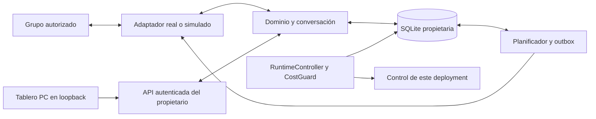

# Arquitectura

Un proceso propietario contiene dominio, inbox/outbox, planificador, transporte y API. SQLite es la fuente activa; no hay sincronización de dos bases que escriben simultáneamente. La PC puede funcionar como propietario local o como proxy autenticado saliente del propietario remoto.

`packages/domain` contiene dinero, fechas, parser y tipos. `apps/service` separa persistencia, conversación, archivos, propiedad, costos, plataforma y transporte. `apps/web` es React servido localmente. Se eligió SQLite integrado en Node 24 para evitar un driver nativo adicional en Windows/Linux; la migración usa SQL con restricciones y transacciones. No se usa un ORM por defecto.

Los registros tipados se guardan como JSON validado con columnas indexadas de tipo, estado y versión. Pagos, cuentas, documentos, vínculos, inbox, drafts, jobs, outbox, auditoría, costos y snapshots tienen tablas propias. Los datos de negocio no se siembran. Las cuentas iniciales tienen saldo y fecha `null`.

Los importes usan enteros de unidades menores; ARS y USD permanecen separados. Transferencias no afectan totales de gasto. La compra con tarjeta se cuenta una vez; cuotas previstas y pago de resumen se distinguen. Las reservas de metas no mueven dinero. Un exceso declarado como crédito conserva una asignación y se separa del gasto reconocido, aunque la salida de cuenta incluye el pago completo.

Se conserva informante y realizador. Las correcciones actualizan el mismo registro y su versión; auditoría y pagos no se borran. El estado financiero deriva de movimientos, sin conciliación bancaria. Los formularios y el chat usan el mismo Engine; las ediciones validan la misma estructura antes del commit.

Las operaciones asincrónicas relevantes comparten una cola serial. Inbox y resultado/outbox se confirman juntos. El ID del mensaje deduplica la operación; no se fusionan deudas por un hash. Cada job incluye versión; completar, pagar, editar o posponer invalida trabajos anteriores. Los envíos inciertos quedan en `delivery_unknown`, con evidencia/manual de revisión, sin reenvío ciego.

RuntimeController valida propietario, generación, cursor y barrera persistente, tanto para emisores como para escrituras de la API. `process.lock` excluye dos procesos de la misma instalación. Un cierre/exportación revoca al propietario anterior antes de transferir. El fence del volumen bloquea un arranque con una base de generación anterior. El importador comprueba también que la historia anterior sea prefijo de la entrante, rechazando ramas divergentes.

La exclusión distribuida exige que el controlador compruebe la parada de Railway y que todas las ejecuciones respeten el mismo volumen/fence. No es un consenso global capaz de impedir que un administrador clone todos los datos y barreras en infraestructura desconocida. La validación del proveedor real sigue pendiente.

La API usa Bearer, comparación de hashes en tiempo constante, validación de cuerpos, límite de tamaño y autorización en backend. PC escucha sólo `127.0.0.1`, valida Host/Origin y no usa cookies de sesión. Railway escucha `0.0.0.0:$PORT` detrás de HTTPS; no sirve el tablero. El token administrativo nunca llega al navegador. Los documentos se sirven como descarga por ID, con nombre seguro, sin rutas arbitrarias ni procesamiento de contenido.

No hay telemetría, fuentes/CDN obligatorios, correo técnico, conexiones a bancos, llamadas a proveedores ni herramientas ejecutadas a partir del chat. La única mutación de plataforma es `deploymentStop`, con alcance validado. No se implementa cifrado en reposo; proteger el perfil/disco y sus permisos.
