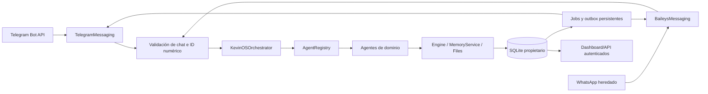

# Arquitectura ORDEN 4.0 / KEVIN OS (borrador anterior)

> Las migraciones y capacidades aquí listadas representan la primera etapa. Consultar [estado actual](ORDEN_4_ESTADO_ACTUAL.md) y [agentes actuales](ORDEN_4_AGENTES_ACTUAL.md).

ORDEN 4.0 extiende el proceso único existente. SQLite sigue siendo la memoria compartida y el dominio existente conserva agenda, dinero, compras, documentos y recordatorios. Los agentes son módulos locales con permisos declarados; no hay ocho servidores ni ocho modelos activos.

El transporte Telegram usa long polling. La API oficial permite webhook o `getUpdates`, pero no ambos al mismo tiempo; la PC no expone un endpoint entrante y el polling permite mantener el mismo proceso en PC o Railway. El adaptador rechaza el arranque si detecta que hay un webhook configurado.

El `AgentRegistry` asigna identificadores estables y lista herramientas permitidas. KevinOS valida el remitente Telegram de nuevo antes de despachar. `Engine` y `MemoryService` hacen las escrituras persistentes y auditables. Una eventual IA podrá interpretar o proponer datos; no se le entregará acceso directo a SQL, archivos, red o herramientas arbitrarias.

Migraciones actuales: `001.sql` (dominio previo), `002_telegram.sql` (cursor y updates), `003_memory.sql` (entidades, hechos y relaciones), `004_intelligence_shopping.sql` (extracciones, catálogo, compras, promociones y agentes) y `005_purchase_line_measurements.sql` (medidas por línea). El runner aplica versiones pendientes en orden dentro de una transacción; no elimina tablas existentes.

La integración local está implementada para Telegram y memoria. La IA local, OCR, investigación web y el procesamiento avanzado de tickets/facturas quedan separados y pendientes. No se envía información familiar a proveedores externos.
